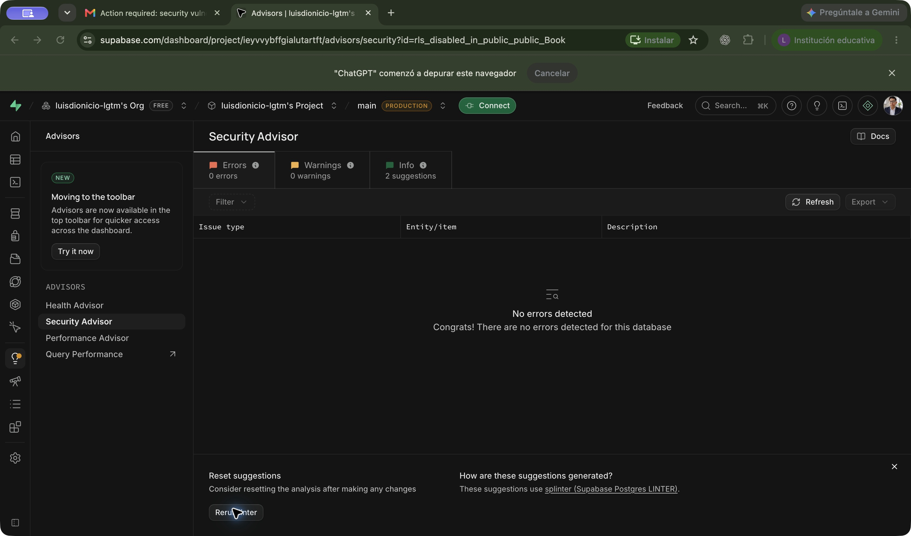

# Corrección de las alertas RLS

El 10 de noviembre de 2026 se corrigieron las alertas `rls_disabled_in_public`
de `public.Author` y `public.Book` en Supabase.

## Cambio aplicado

- Se activó Row Level Security en ambas tablas.
- Se revocaron todos los permisos sobre estas tablas de `anon`, `authenticated`
  y `PUBLIC`, incluido `TRUNCATE`, que no está protegido por políticas de filas.
- No se crearon políticas de acceso desde clientes: esta aplicación utiliza
  Prisma en el servidor, con su conexión PostgreSQL almacenada en variables de
  entorno, y no utiliza la Data API de Supabase desde el navegador.

El SQL reproducible e idempotente está en
[`prisma/security/enable-library-rls.sql`](../prisma/security/enable-library-rls.sql).
Debe aplicarse después de crear las tablas en cualquier nuevo entorno. No basta
con ejecutar `prisma db push` para aplicar esta configuración de seguridad.

## Verificación

- Security Advisor: **0 errores y 0 advertencias** después de ejecutar de nuevo
  el análisis. Quedan dos avisos informativos `RLS Enabled No Policy`: el bloqueo
  de la Data API es intencional.
- Ambas tablas tienen RLS activado y se deniegan las 28 comprobaciones de permisos
  directos para los roles `anon` y `authenticated`.
- Las 26 pruebas de integración de la aplicación desplegada en Vercel pasaron,
  incluidas creación, lectura, actualización y eliminación de registros temporales.
- También pasaron las pruebas avanzadas de búsqueda, filtros, paginación,
  ordenamiento y estadísticas de autor.

Resultados: [`verificacion-rls.json`](verificacion-rls.json) y
[`resultados-integracion.json`](resultados-integracion.json).

## Alcance

Esta corrección bloquea el acceso directo a las tablas mediante los roles de la
Data API. El backend usa actualmente el rol `postgres`, que omite RLS. Por eso
el CRUD de Next.js conserva el comportamiento público de la demostración: RLS
no agrega inicio de sesión ni autorización a las rutas de Next.js. Esas medidas
son necesarias antes de utilizar datos sensibles.

Referencia: [Row Level Security de Supabase](https://supabase.com/docs/guides/database/postgres/row-level-security).
